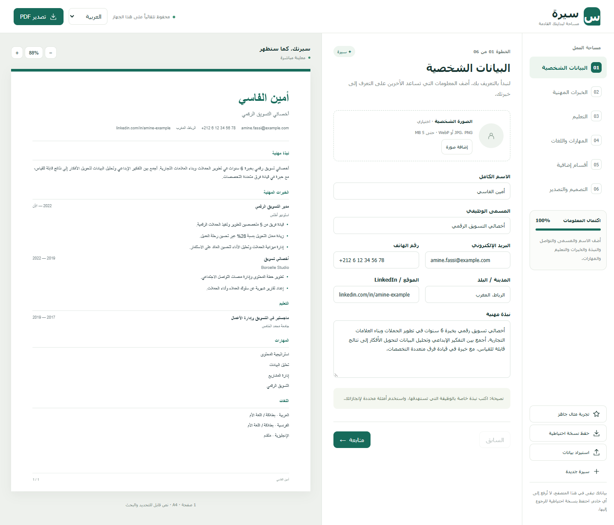
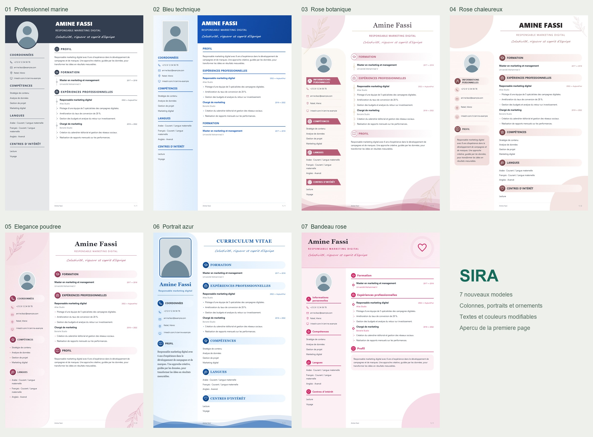

# Sira — CV Builder

**Create a multilingual CV directly in your browser. No installation, account, or backend required.**

Sira (سيرة) is a standalone web application built with HTML, CSS, and vanilla JavaScript. It combines a guided editor with a live A4 preview and customizable resume templates.



## Features

- Arabic, French, and English interfaces, with a separate language choice for CV headings.
- Ten templates, customizable colors, and normal or compact spacing.
- Right-to-left support for Arabic and responsive layouts.
- Sections for personal details, experience, education, skills, languages, certificates, training, software, and references.
- Optional photo upload with image compression.
- Automatic local saving, JSON backup and restore, entry reordering, and undo after deletion.
- Multi-page A4 layout with PDF and PNG export.
- Offline operation with no external libraries or network dependencies.

## Try it online

**[Launch Sira CV Builder →](https://badr-elfahm.github.io/sira-cv-builder/)**

Open the link and start building your CV—no download required. For offline use, follow the steps below.

## Get started

1. Select **Code → Download ZIP** on GitHub and extract the archive.
2. Open **index.html** in a recent version of Microsoft Edge or Google Chrome.
3. Enter your details or load the built-in example.
4. Choose a template, accent color, and CV language.
5. Export your CV and save a JSON backup if you want to edit it later.

No package manager or build step is needed. To work with Git:

```sh
git clone https://github.com/Badr-Elfahm/sira-cv-builder.git
cd sira-cv-builder
```

Then open `index.html` in your browser.

## Export options

| Format | How it works |
| --- | --- |
| Direct PDF download | Combines high-resolution page images into one PDF. Text is not selectable. |
| Print / text PDF | Uses the browser print dialog. Select Save as PDF, A4, and disable browser headers and footers. |
| PNG | Exports each page at 2382 × 3369 pixels. Multiple pages can be downloaded in a ZIP. |

## Templates



## Privacy and storage

CV data stays in browser storage on your device; the application does not upload it to a server. Exported backups and CVs contain the information you enter, so keep them somewhere appropriate.

Browser storage can be cleared and may differ between local file paths, browsers, or hosted URLs. Save a JSON backup before moving the application or clearing browser data. Changing the interface or heading language does not translate your entered text.

## Project structure

```text
index.html              Application, styles, and scripts
README.md               English overview and quick start
GUIDE.ar.md             Detailed Arabic user guide
sira-preview.png        Editor screenshot with demo data
templates-preview.jpg   Template previews
```

## Development

Edit `index.html` and refresh it in your browser. The app uses browser APIs for local storage, image rendering, downloads, and printing. Direct PDF and PNG export use rasterized pages; use the browser print option when selectable text is needed.

The accompanying Arabic guide records prior testing in Microsoft Edge, including offline use, local saving, imports, templates, and exports. Export behavior and print dialogs may vary across browsers and mobile devices.

## Author

Built by [Badr](https://github.com/Badr-Elfahm) using web development and AI-assisted tools.

[اقرأ دليل الاستخدام بالعربية](GUIDE.ar.md)
